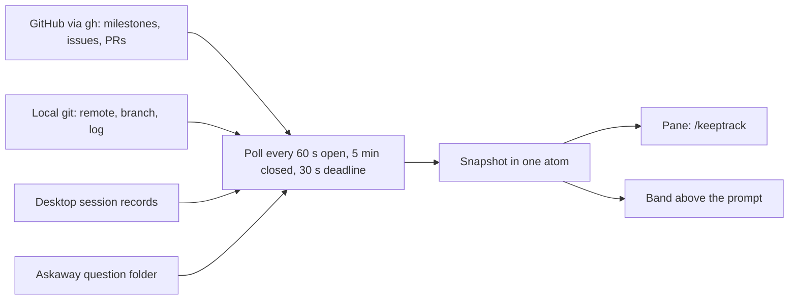
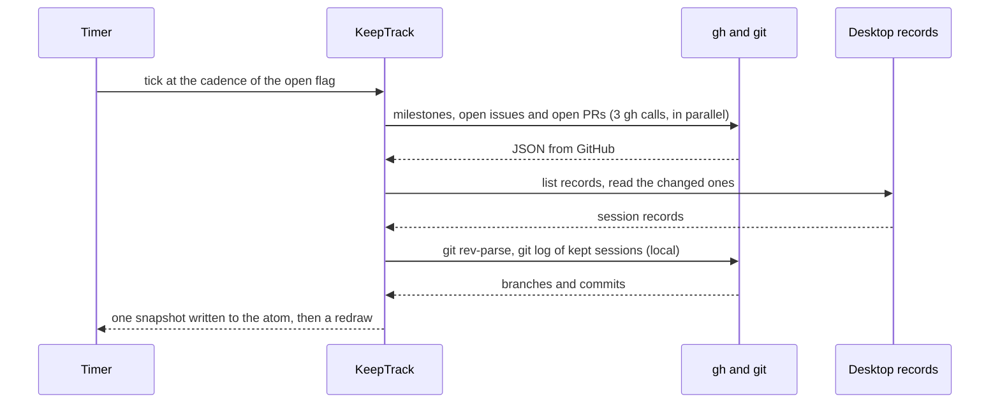

# 🧭 KeepTrack

[](README.md) [-green.svg)](README.pt-BR.md)

KeepTrack is a Claude Code Desktop mod that shows which issue each session of a repository works on, and what the repository is doing right now.

 

## 📌 Status

Beta (`0.2.0-beta.5`). The project follows [SemVer](https://semver.org/): while the version is `0.y.z`, any release may change behavior without notice.

## 💡 Why it exists

When one repository has several Desktop sessions open at once, each session shows only its own conversation. Nothing tells you which session works on which issue, which issues no session touches, or whether a session is waiting for you. KeepTrack reads that information from GitHub and from this machine, and draws it in two places: a pane and a band above the prompt.

It does **not** change anything on GitHub or in your repository. It does not track time, store reports, or sync between machines.

## 🎁 What it delivers

- **`/keeptrack`** opens the pane. `/keeptrack issue <n>` sets the issue of this window, and `/keeptrack issue none` clears it. `/keeptrack lang en|pt-BR|auto` sets the language.
- **This window first**: the session of the window with its issue's details and timeline.
- **Nested sessions**: the other Desktop sessions of the same repository, under their parent when they are derived (fork or spawn). Each session title links to its Desktop session.
- **Open issues by milestone**: the open issues that no session works on, grouped by open milestone, with the milestone progress.
- **A band above the prompt** with the state of this window: running or idle, the current tool or MCP server with its icon, the number of agents, the elapsed time, a waiting-for-you state, a data-error state, the milestone progress and the issue number.
- **An Open button** on the band, with the KeepGlide mark before it.
- **English and Brazilian Portuguese** in the pane and the band.

## 📸 Screenshots

> **Design mocks, not captures.** The two images below are the approved design mock of the session-first layout (light and dark), not screenshots of the running Desktop app. Real captures of the band and the pane come with the next release.

| Light | Dark |
|---|---|
|  |  |

## ⚙️ How it works



The main round trip of one poll:



A poll that is not settled after 30 seconds is abandoned, and a newer poll may start. The pane and the band only read the snapshot; they call no process and no file.

The session-to-issue mapping takes the first match and never merges two sessions. The full rules are in [the spec](plugins/keeptrack-repo-pane/SPEC.md).

## 📋 Prerequisites

- Claude Code Desktop with the mod loader.
- [`gh`](https://cli.github.com/), signed in with `gh auth login`, with read access to the repository.
- `git`, and a repository whose remote points to GitHub.

## 🚀 Installation

> **Pending:** the KeepGlide catalog ([KeepGlide/claude-plugins](https://github.com/KeepGlide/claude-plugins)) has no `keeptrack` entry yet, so there is no one-command install. The commands below follow the Askaway pattern and are not run yet for this plugin. The entry and the verified commands come with the next release.

When the entry is published, the install is:

### 1️⃣ Add the marketplace

```bash
claude plugin marketplace add KeepGlide/claude-plugins
```

### 2️⃣ Install the plugin

```bash
claude plugin install keeptrack-repo-pane@keepglide
```

### 3️⃣ Load it

Restart Claude Code, or run `/reload-plugins` if your version has it. Then run `/keeptrack` in a session of a repository with a GitHub remote.

### Uninstall

```bash
claude plugin uninstall keeptrack-repo-pane@keepglide
```

## 🤖 Install with an AI agent (spec)

> **Pending.** This spec is written when the catalog entry exists and each **Expect** is checked against a real run. Until then, no agent should follow it.

## 🧭 Usage

| Command | What it does |
|---|---|
| `/keeptrack` or `/keeptrack open` | Opens the pane and polls at once when the snapshot is older than one interval. |
| `/keeptrack issue <n>` | Sets the issue of this window. The value is stored per session. |
| `/keeptrack issue none` | Clears the issue of this window. |
| `/keeptrack lang en\|pt-BR\|auto` | Stores the language and switches it at once. `auto` follows the environment. |

## 🎛️ Configuration

| Name | Default | Effect |
|---|---|---|
| `KEEPTRACK_POLL_MS` | `60000` | Poll interval while the pane is open. At least 1000 ms. |
| `KEEPTRACK_BAND_POLL_MS` | `300000` | Poll interval while the pane is closed. At least 1000 ms. |
| `KEEPTRACK_DESKTOP_SESSIONS` | Desktop folder under the home directory | Records root that is read instead of the default. Set for tests. |

Fixed in the code, not configurable: the poll deadline is 30 seconds (`POLL_DEADLINE_MS` in `plugins/keeptrack-repo-pane/hooks/register.tsx`), and the band redraws on a 30-second tick (`BAND_TICK_MS`).

## 🔒 Security and privacy

- **What leaves the machine:** only `gh` calls to GitHub, to read milestones, open issues, open pull requests and one issue's details. There are no paid calls and no calls to other services.
- **What is read locally:** the git remote, branch and log of the repository and of its sessions, the Desktop session records, and the Askaway question folder (`ASKAWAY_HOME`, or `~/.claude/state/askaway`).
- **What is written:** only the state of the mod (the open flag, the language and the issue set by `/keeptrack issue`). Nothing is written to GitHub or to the repository.
- To report a vulnerability, see [SECURITY.md](SECURITY.md).

## 🧪 Tests

| Category | Tests |
|---|---|
| Rules: remote parsing, session tree, issue groups, timelines, record projection (`tests/model.test.ts`) | 60 |
| Hooks module: poll, pane command, timers and close (`tests/register.test.ts`) | 61 |
| Band: status line, states and Open button (`tests/band.test.ts`) | 36 |
| Pane: snapshot drawing (`tests/pane.test.ts`) | 23 |
| Language: English and pt-BR dictionaries (`tests/i18n.test.ts`) | 8 |
| Turn transitions of the band (`tests/turn.test.ts`) | 6 |
| **Total** | **194** |

Counts from `claude plugin test plugins/keeptrack-repo-pane` (194 pass, 0 fail), on 2026-10-21, before the first commit.

## 🔧 Development

From the repository root:

```bash
claude plugin test plugins/keeptrack-repo-pane
```

```bash
bash plugins/keeptrack-repo-pane/scripts/keeptrack-look-check.sh
```

The look check fails on any hex colour, colour function or emoji in the drawn code. The layout of the repository and the test protocol are in [CONTRIBUTING.md](CONTRIBUTING.md).

## 📝 Changelog

The changes of each version are in [CHANGELOG.md](CHANGELOG.md), in the [Keep a Changelog](https://keepachangelog.com/en/1.1.0/) format. The project follows SemVer.

## 🤝 Contributing

Pull requests are welcome. Read [CONTRIBUTING.md](CONTRIBUTING.md) first.

## 🧑‍🔧 Maintainer

Sophia Phillipa (KeepGlide), [keepglide.com](https://keepglide.com).

## 📄 License

MIT. Copyright (c) 2026 Sophia Phillipa (KeepGlide). SPDX identifier: `MIT`. See [LICENSE](LICENSE).
