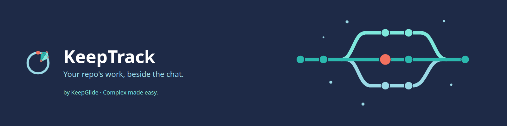
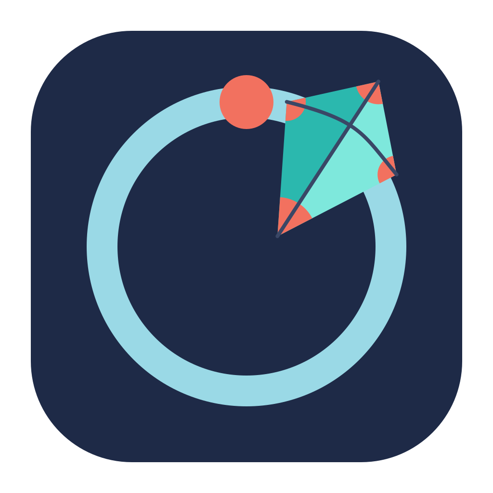
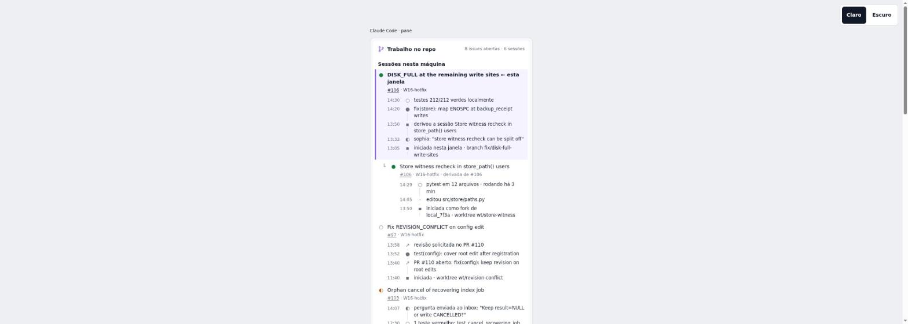
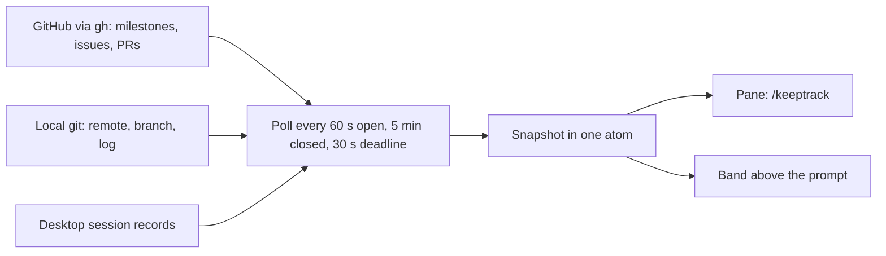
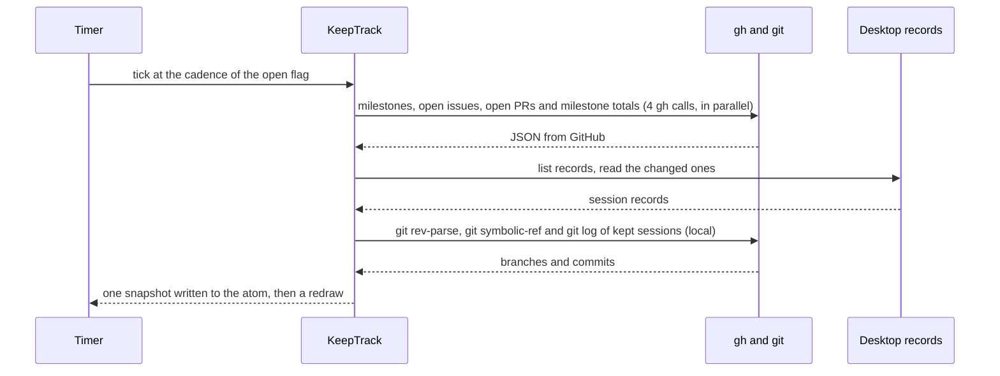

<div align="center">





# 🧭 KeepTrack

[](README.md) [-green.svg)](README.pt-BR.md)

**A Claude Code Desktop mod for people who run several sessions on one GitHub repository. It shows which issue each session works on, and what the repository is doing right now.**

[](CHANGELOG.md) [](LICENSE) 

[Installation](#-installation) · [Usage](#-usage) · [Changelog](CHANGELOG.md) · [Report a bug](https://github.com/KeepGlide/keeptrack/issues/new) · [Security](SECURITY.md)

</div>

<details>
<summary><strong>📑 Contents</strong></summary>

- [📌 Status](#-status)
- [💡 Why it exists](#-why-it-exists)
- [🎁 What it delivers](#-what-it-delivers)
- [📸 Screenshots](#-screenshots)
- [⚙️ How it works](#%EF%B8%8F-how-it-works)
- [📋 Prerequisites](#-prerequisites)
- [🚀 Installation](#-installation)
- [🤖 Install with an AI agent (spec)](#-install-with-an-ai-agent-spec)
- [🔄 Updating](#-updating)
- [🧹 Uninstall](#-uninstall)
- [🧭 Usage](#-usage)
- [🎛️ Configuration](#%EF%B8%8F-configuration)
- [📚 Documentation](#-documentation)
- [🔒 Security and privacy](#-security-and-privacy)
- [🩺 Troubleshooting](#-troubleshooting)
- [🐞 Known issues](#-known-issues)
- [🧪 Tests](#-tests)
- [🔧 Development](#-development)
- [🌿 Branching and releases](#-branching-and-releases)
- [📝 Changelog](#-changelog)
- [🤝 Contributing](#-contributing)
- [🧑‍🔧 Maintainer](#-maintainer)
- [📄 License](#-license)

</details>

## 📌 Status

Beta (`0.2.0-beta.8`). The project follows [SemVer](https://semver.org/): while the version is `0.y.z`, any release may change behavior without notice.

## 💡 Why it exists

When one repository has several Desktop sessions open at once, each session shows only its own conversation. Nothing tells you which session works on which issue, which issues no session touches, or whether a session is waiting for you. KeepTrack reads that information from GitHub and from this machine, and draws it in two places: a pane and a band above the prompt.

It is for one person on one machine: it reads that machine's session records.

It does **not** change anything on GitHub or in your repository. It does not track time, store reports, or sync between machines.

## 🎁 What it delivers

- **`/keeptrack`** opens the pane (`/keeptrack open` does the same). `/keeptrack issue <n>` sets the issue of this window, `/keeptrack issue none` clears it, and `/keeptrack lang en|pt-BR|auto` sets the language.
- **This window first**: the session of the window with its issue's details and timeline.
- **Sessions grouped as in the Desktop sidebar**: the group label on top, in plain bold text, then its sessions. A session filed in a Desktop sidebar Group (its own, or its root's) is drawn under the Group's name; every session without a Group is listed under one group labelled `Recents`, as the Desktop sidebar names them. The label is `Recents` in both languages, because the Desktop app has no translated label, and a Desktop Group named "Recents" keeps its own label next to it. Each top session is a titled `├`/`└` row with its state, issue and milestone, and its derived sessions (fork or spawn) are nested under it at 1, 3 and 5 cells. This window's group comes first, then the named Groups by newest activity, then `Recents`; inside a group, this window's session comes first, then the newest. Each session title links to its Desktop session.
- **Ended sessions are not listed**: an archived Desktop session leaves the tree at once, unless it is this window's own session. An archived root is not drawn: its live derived sessions are rows of their group (`Recents` when they have no Group), with the parent's title in their timeline.
- **Open issues by milestone**: the open issues that no session works on, grouped by open milestone, with the milestone progress. Milestones sort by due date, earliest first; inside a group the issues sort by priority (`P0` to `P3`, read from the labels), and each row carries its tag.
- **A band above the prompt** with the state of this window: running or idle, the current tool or MCP server with its icon, the number of agents, the elapsed time, a waiting-for-you state, a data-error state, the milestone progress and the issue number. The band says `Running` and `Idle`, and the pane says `working` and `idle`, by design: the two vocabularies are kept apart on purpose.
- **An Open button** on the band, with the KeepGlide mark before it (the mark shows on Desktop only).
- **English and Brazilian Portuguese** in the pane and the band.

## 📸 Screenshots

> [!NOTE]
> **Design mocks, not captures.** The two images below are the approved design mock of the session-first layout (light and dark), not screenshots of the running Desktop app.

| Light | Dark |
|---|---|
|  |  |

> [!IMPORTANT]
> **Real captures are pending.** They wait for Sophia's check of the running mod in Claude Code Desktop ([SPEC §17](plugins/keeptrack-repo-pane/SPEC.md#17-desktop-check-for-sophia)). Until then, the slots below hold no image.

| Screen | Capture |
|---|---|
| Pane, light theme | Pending Sophia's Desktop check (SPEC §17) |
| Pane, dark theme | Pending Sophia's Desktop check (SPEC §17) |
| Band above the prompt | Pending Sophia's Desktop check (SPEC §17) |

## ⚙️ How it works



The main round trip of one poll:



The timer polls every 60 seconds while the pane is open and every 5 minutes while it is closed, so the band stays current. A poll that is not settled after 30 seconds is abandoned, and a newer poll may start. The pane and the band only read the snapshot; they call no process and no file.

The session-to-issue mapping takes the first match and never merges two sessions. The full rules are in [the spec](plugins/keeptrack-repo-pane/SPEC.md).

## 📋 Prerequisites

- Claude Code Desktop with the mod loader.
- [`gh`](https://cli.github.com/), signed in with `gh auth login`, with read access to the repository.
- `git`, and a repository with a remote on GitHub: `origin`, or the first remote when there is no `origin`. A remote on another host shows as `no GitHub remote`.

| Platform | Status | Notes |
|---|---|---|
| Claude Code Desktop on Linux | ✅ | |
| Claude Code Desktop on macOS | ⚠️ | Not tested. The default records folder is the same `~/.config/Claude/claude-code-sessions` path; the code does not check it on macOS. |
| Claude Code Desktop on Windows | ⚠️ | Not tested. Both default folders are built from `HOME`; when `HOME` is unset, the code finds no folder. |

## 🚀 Installation

KeepTrack is installed from `sophia-mods`, the local marketplace of Sophia's Claude Code mods: the folder `~/.claude/mods`, whose `.claude-plugin/marketplace.json` lists `keeptrack-repo-pane`.

### 1️⃣ Add the marketplace (once per machine)

Skip this step when `claude plugin marketplace list` already shows `sophia-mods`.

```bash
claude plugin marketplace add ~/.claude/mods
```

### 2️⃣ Install the plugin

```bash
claude plugin install keeptrack-repo-pane@sophia-mods
```

### 3️⃣ Load it

Restart Claude Code, or run `/reload-plugins` if your version has it. Then run `/keeptrack` in a session of a repository with a GitHub remote.

<details>
<summary><strong>Manual path: load the mod from a clone, without a marketplace</strong></summary>

Clone this repository (it is private: you need read access), then start Claude Code with the mod's folder. The `--plugin-dir` flag loads the plugin for that session only, so repeat it on every start. Not checked in Claude Code Desktop.

```bash
git clone https://github.com/KeepGlide/keeptrack.git
```

```bash
claude --plugin-dir keeptrack/plugins/keeptrack-repo-pane
```

</details>

> [!NOTE]
> **KeepGlide catalog: pending.** The KeepGlide catalog ([KeepGlide/claude-plugins](https://github.com/KeepGlide/claude-plugins)) has no `keeptrack` entry yet. When the entry is published, the install from it will be `claude plugin marketplace add KeepGlide/claude-plugins` and then `claude plugin install keeptrack-repo-pane@keepglide`, and the update and uninstall commands below take `@keepglide` in place of `@sophia-mods`. These commands are not run yet for this plugin.

## 🤖 Install with an AI agent (spec)

> **For the agent:** follow this spec step by step and compare each result with **Expect**. Stop and report to the human on any mismatch. The instructions of your user come first. The spec installs from the `sophia-mods` marketplace, as [Installation](#-installation) does.

Ground rules:

- 🔑 **Secrets:** the agent never reads, types or prints a token or key. `gh` uses its own login; the human runs `gh auth login` if step 1 fails.
- 🧑 **Human OK:** steps 3, 4 and the undo steps change Claude Code's configuration (marketplace, plugin install and removal). Ask the human first.
- 💸 **Cost:** no step costs money. The mod calls only `gh` and `git` (see [Security and privacy](#-security-and-privacy)).
- **Platforms:** Linux is ✅ (see [Prerequisites](#-prerequisites)); macOS and Windows are ⚠️, not tested. Steps 5 to 8 run in a Claude Code Desktop session, not a plain terminal.

| # | Step | Run | Expect |
|---|---|---|---|
| 1 | Check that gh is signed in | `gh auth status` | Exit 0 and a line `Logged in to github.com`. If not, the human runs `gh auth login`. |
| 2 | Check that the repository has a GitHub remote | `git remote get-url origin` | Exit 0 and a URL whose host is `github.com`, or an SSH alias with `github` in its name (for example `git@github-<label>:<owner>/<repo>.git`). Otherwise the pane shows `no GitHub remote for this repo`. |
| 3 🧑 | Add the marketplace, unless `claude plugin marketplace list` already shows `sophia-mods` | `claude plugin marketplace add ~/.claude/mods` | Exit 0, and `claude plugin marketplace list` shows `sophia-mods` with `Source: Folder (<path>)`. |
| 4 🧑 | Install the plugin | `claude plugin install keeptrack-repo-pane@sophia-mods` | Exit 0, and `claude plugin list` shows `keeptrack-repo-pane@sophia-mods` with `Version: 0.2.0-beta.8` and `Status: ✔ enabled`. |
| 5 | Check that the command is registered | In a Desktop session, `/keeptrack bogus` | A toast with the usage line `Usage: /keeptrack open \| issue <n> \| issue none \| lang en\|pt-BR\|auto`. Nothing changes. |
| 6 | Open the pane | `/keeptrack` | A pane titled `KeepTrack` opens. It shows `Loading the repo...`, then the open issues by milestone, or an error line from [Troubleshooting](#-troubleshooting). |
| 7 | Switch the language to Portuguese | `/keeptrack lang pt-BR` | The pane and the band switch to Portuguese. While loading, the pane shows `Carregando o repo...`. |
| 8 | Return to the automatic language | `/keeptrack lang auto` | The stored choice is removed. The language follows the first set variable of `LC_ALL`, `LC_MESSAGES`, `LANG` or `LANGUAGE`: `pt*` gives Portuguese, anything else gives English. |
| 9 | Check that gh reads the repository | `gh issue list -R <owner>/<repo> --state open --limit 1 --json number` | Exit 0 and a JSON array: `[]` or `[{"number":<n>}]`. |
| 10 | Hand back | none | Report to the human the result of each step, the output of step 9 and any skipped step. No token is printed. |

✅ **Done when:** steps 1, 2 and 9 match; steps 3 and 4 match; steps 5 to 8 match in a Desktop session.

**Report:** the result of each step, the output of step 9, and every skipped step with its reason.

**Undo** (🧑 the human decides):

1. Run `/keeptrack lang auto` and `/keeptrack issue none` in each window where they were used.
2. Run `claude plugin uninstall keeptrack-repo-pane@sophia-mods`.
3. Run `claude plugin marketplace remove sophia-mods` only if step 3 added it and no other plugin uses that marketplace.

## 🔄 Updating

Refresh the marketplace, then update the plugin. The update prints `updated from <old> to <new>` and `Restart to apply changes`.

```bash
claude plugin marketplace update sophia-mods
```

```bash
claude plugin update keeptrack-repo-pane@sophia-mods
```

Restart Claude Code, or run `/reload-plugins`, after an update, as after an install.

## 🧹 Uninstall

```bash
claude plugin uninstall keeptrack-repo-pane@sophia-mods
```

Restart Claude Code, or run `/reload-plugins`, afterwards. What the mod leaves behind:

| Item | Where | After uninstall |
|---|---|---|
| Plugin code and hooks | Claude Code's plugin installation | Removed by `claude plugin uninstall`. |
| Stored language (`lang`) and window issues (`override:<session id>`) | The mod's store in Claude Code | Stay. The mod has no step that deletes them. Overrides expire after 30 days, or earlier when no session record lists their session. To clear the language first, run `/keeptrack lang auto`. |
| Session records and the Desktop config | `~/.config/Claude/claude-code-sessions`, `~/.config/Claude/claude_desktop_config.json` (only the sidebar Groups and their session assignments are read) | Not touched. The mod only reads them. |
| GitHub and the repository | GitHub and your working tree | Not touched. The mod writes nothing there. |

## 🧭 Usage

| Command | What it does |
|---|---|
| `/keeptrack` or `/keeptrack open` | Opens the pane. It polls at once when the snapshot is older than one interval. The band's Open button does the same. |
| `/keeptrack issue <n>` | Sets the issue of this window, from 1 to 999999. Stored per session as `override:<session id>` for 30 days. Only a Desktop session can set it; any other window gets a toast. |
| `/keeptrack issue none` | Clears the issue of this window. |
| `/keeptrack lang en\|pt-BR\|auto` | Stores the language (case does not matter) and switches it at once. `auto` removes the stored choice and follows the environment. |
| Any other argument | A toast with the usage line. Nothing changes. Extra words after `open` or `issue <n>` (for example `/keeptrack open now`) count as another argument. |

## 🎛️ Configuration

| Name | Default | Effect |
|---|---|---|
| `KEEPTRACK_POLL_MS` | `60000` | Poll interval while the pane is open. A value below 1000, or one that is not a whole number, is ignored and the default is used. |
| `KEEPTRACK_BAND_POLL_MS` | `300000` | Poll interval while the pane is closed. Same rule as `KEEPTRACK_POLL_MS`. |
| `KEEPTRACK_DESKTOP_SESSIONS` | `$HOME/.config/Claude/claude-code-sessions` | Session records folder that is read (read only). Set for tests. |
| `LC_ALL`, `LC_MESSAGES`, `LANG`, `LANGUAGE` | unset | Language when no choice is stored: the first one that is set decides. `pt*` gives Portuguese; anything else gives English. A stored `/keeptrack lang` choice always wins. |

The default folder is built from `HOME`. When `HOME` is unset, the mod finds no records folder.

Fixed in the code, not configurable:

| Setting | Value | Where |
|---|---|---|
| Poll deadline | 30 s | `POLL_DEADLINE_MS`, `plugins/keeptrack-repo-pane/hooks/register.tsx` |
| Band redraw tick | 30 s | `BAND_TICK_MS`, `plugins/keeptrack-repo-pane/hooks/register.tsx` |
| gh call timeout | 15 s | `GH_TIMEOUT_MS`, `plugins/keeptrack-repo-pane/hooks/register.tsx` |
| git call timeout | 5 s | `GIT_TIMEOUT_MS`, `plugins/keeptrack-repo-pane/hooks/register.tsx` |
| Open issues per poll | 500 | `ISSUE_LIMIT`, `plugins/keeptrack-repo-pane/hooks/register.tsx` |
| Open pull requests per poll | 100 | `PR_LIMIT`, `plugins/keeptrack-repo-pane/hooks/register.tsx` |
| Session cutoff | 72 h | `SESSION_CUTOFF_MS`, `plugins/keeptrack-repo-pane/hooks/register.tsx` |
| Issue override lifetime | 30 days | `OVERRIDE_TTL_MS`, `plugins/keeptrack-repo-pane/hooks/register.tsx` |
| Abandoned polls allowed at once | 2 | `MAX_ABANDONED_POLLS`, `plugins/keeptrack-repo-pane/hooks/register.tsx` |
| Working-state window | 5 min after the last activity | `WORKING_WINDOW_MS`, `plugins/keeptrack-repo-pane/hooks/model.ts` |

## 📚 Documentation

- [SPEC.md](plugins/keeptrack-repo-pane/SPEC.md): what the code does now, and where it differs from the design record.
- [CONTRIBUTING.md](CONTRIBUTING.md): the repository layout and the test protocol.
- [CHANGELOG.md](CHANGELOG.md): every change, by version.

## 🔒 Security and privacy

- **What leaves the machine:** only `gh` calls to GitHub, to read milestones, open issues, open pull requests, the milestone totals and one issue's details. There are no paid calls and no calls to other services.
- **What is read locally:** the git remote, branch and log of the repository and of its sessions, the Desktop session records, and the Desktop config (its sidebar Groups only).
- **What is written:** only the state of the mod (the open flag, the language and the issue set by `/keeptrack issue`). Nothing is written to GitHub or to the repository.
- To report a vulnerability, see [SECURITY.md](SECURITY.md).

## 🩺 Troubleshooting

| Symptom | Cause | Fix |
|---|---|---|
| `claude plugin install keeptrack-repo-pane@keepglide` finds no plugin | The catalog entry is not published yet (see [Installation](#-installation)). | Install from `sophia-mods`, or wait for the entry. |
| `gh not found: showing sessions only` | `gh` cannot start (not installed, or not on the path Claude Code sees). | Install [`gh`](https://cli.github.com/) and check it with `gh --version`. |
| `gh is not signed in` | `gh` exits with a login message. | Run `gh auth login`. The next poll uses it (60 s with the pane open, 5 min closed). |
| `GitHub rate limit: showing the last data` | GitHub's API rate limit was reached. | Wait. The last data stays on screen until a poll succeeds. |
| `GitHub did not answer in time` | A `gh` call ran longer than 15 s. | Check the network, and run the failing call by hand. The next poll retries. |
| `GitHub did not answer as expected: showing the last data` | A `gh` call failed without a known cause, or its output could not be read. | Run `gh issue list -R <owner>/<repo> --state open` by hand to see the error. |
| `no GitHub remote for this repo` | The repository has no remote on GitHub. | Check `git remote -v`. The remote must point to `github.com`, or to an SSH alias with `github` in its name. |
| `list is partial (first 500)` (or `first 100`) | The repository has more open issues (or pull requests) than one poll reads. Exactly 500 open issues does not show the line. | None in the mod. The list is partial by design. |
| `{count} session records could not be read` | A records file did not parse, or a text field is over 4096 characters. For one record the line reads `1 session record could not be read`. Only `local_<id>.json` files are read as records; other files in the folder, such as `scheduled-tasks.json` and `deleted_<id>` tombstones, are ignored. | The bad record is skipped and the other sessions are shown. |
| `git failed in this folder · sessions shown without branch` | `git` failed in a session's folder. | Check that the folder exists and that `git status` works there. |
| `This window is not a Desktop session: nothing to set` | `/keeptrack issue` ran in a window with no Desktop record. | Run it in a Desktop session window. |
| The pane stays on `Loading the repo...` | The first poll has not settled, or was abandoned after 30 s. | Wait one poll. The mod logs `poll skipped` when two abandoned polls are still running, and then starts nothing until one ends. |

## 🐞 Known issues

No known open issues as of 2026-10-22. Found one? [Open an issue](https://github.com/KeepGlide/keeptrack/issues/new).

Known limitations, as the code does them today:

- **A merged pull request does not link its issue.** Only open pull requests are queried, so an issue whose PR was merged does not show that PR. Workaround: `/keeptrack issue <n>` in the window sets the issue by hand.
- **Archived sessions are never listed.** An archived session leaves the tree at once, even when its branch has an open PR, unless it is this window's session. Its live derived sessions stay listed in their group, with its title only in their timeline. Workaround: none; reopen the session from the Desktop sidebar to see it again.
- **Checks always read `no CI`.** The mod reads the check rollup of open pull requests, but the Checks line always reads `no CI` because the issue details do not pass it through. The KeepGlide repositories run no GitHub Actions. Workaround: none.
- **The working state is a heuristic.** A session counts as working for 5 minutes after its last activity, so the band can lag the real state. Workaround: none.
- **Only GitHub remotes count.** A remote on another host shows as `no GitHub remote`. gh is called without a host, so a GitHub Enterprise host whose name contains `github` is read from github.com; the maintainer accepts this. Workaround: none.
- **Lists are capped per poll.** 500 open issues and 100 open pull requests are read; past that the pane shows `list is partial`. Workaround: none. The milestone totals do not come from that capped list: GraphQL counts them, for the first 100 open milestones.

## 🧪 Tests

| Category | Tests |
|---|---|
| Rules: remote parsing, session tree, issue groups, timelines, record projection (`tests/model.test.ts`) | 93 |
| Hooks module: poll, pane command, timers and close (`tests/register.test.ts`) | 129 |
| Band: status line, states and Open button (`tests/band.test.ts`) | 39 |
| Pane: snapshot drawing (`tests/pane.test.ts`) | 62 |
| Language: English and pt-BR dictionaries (`tests/i18n.test.ts`) | 10 |
| Turn transitions of the band (`tests/turn.test.ts`) | 8 |
| **Total** | **341** |

Counts from `claude plugin test plugins/keeptrack-repo-pane` on the working tree, unreleased: 332 pass, 0 fail, 6 files.

## 🔧 Development

From the repository root, validate the manifest, hooks and types:

```bash
claude plugin validate plugins/keeptrack-repo-pane
```

Run the tests:

```bash
claude plugin test plugins/keeptrack-repo-pane
```

Run the look check, which fails on any hex colour, colour function or emoji in the drawn code (`action-icons.ts` is exempt from the emoji check only):

```bash
bash plugins/keeptrack-repo-pane/scripts/keeptrack-look-check.sh
```

The layout of the repository and the test protocol are in [CONTRIBUTING.md](CONTRIBUTING.md).

## 🌿 Branching and releases

`main` is the only long-lived branch. Make each change on a short branch from `main`, keep it small, run the tests, and open a pull request. Releases are SemVer tags on `main`, each with its entry in [CHANGELOG.md](CHANGELOG.md). No GitHub Release is published yet.

## 📝 Changelog

The changes of each version are in [CHANGELOG.md](CHANGELOG.md), in the [Keep a Changelog](https://keepachangelog.com/en/1.1.0/) format. The project follows SemVer.

## 🤝 Contributing

Pull requests are welcome. Read [CONTRIBUTING.md](CONTRIBUTING.md) first.

## 🧑‍🔧 Maintainer

Sophia Phillipa (KeepGlide), [keepglide.com](https://keepglide.com).

## 📄 License

MIT. Copyright (c) 2026 Sophia Phillipa (KeepGlide). SPDX identifier: `MIT`. See [LICENSE](LICENSE).
