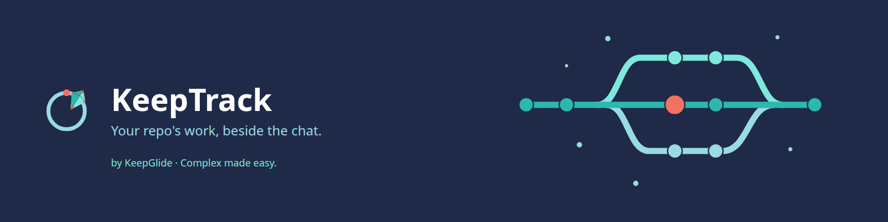
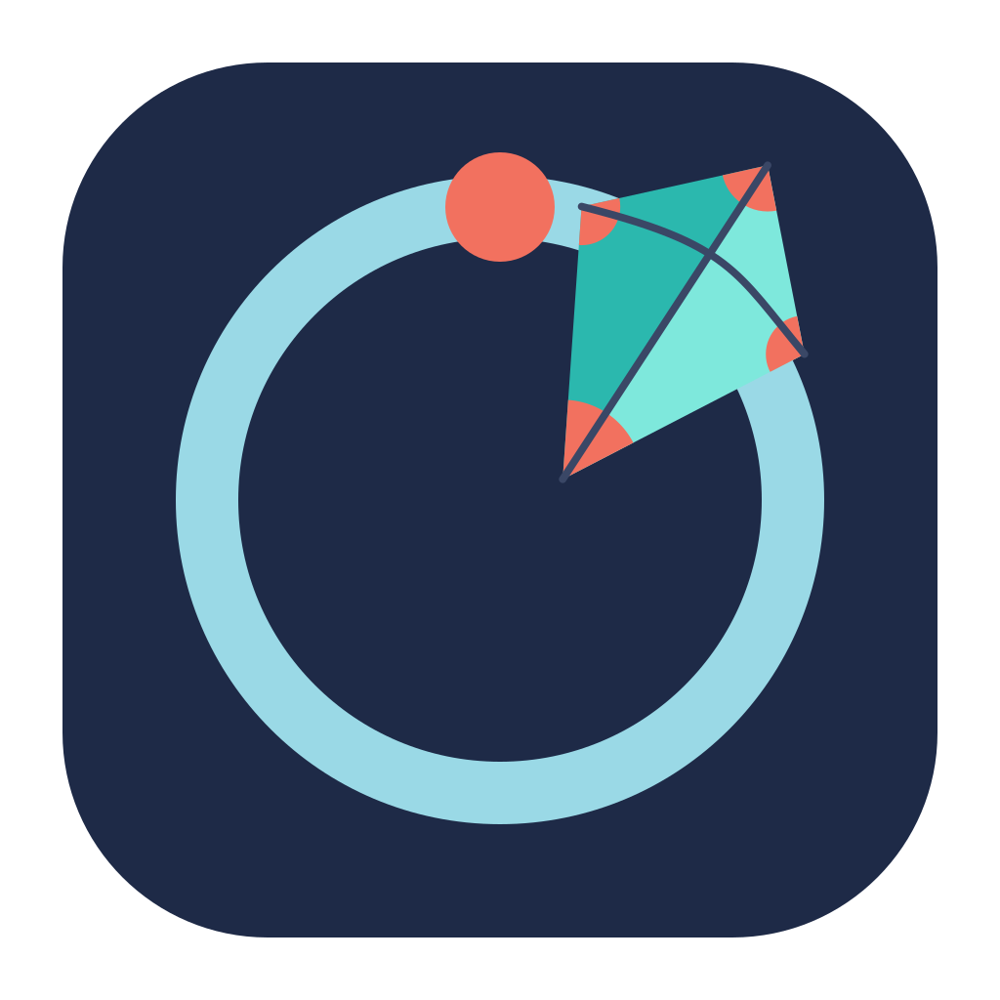
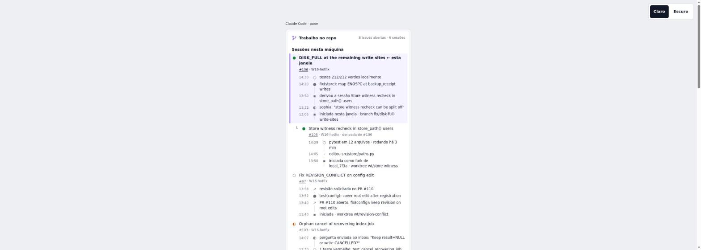
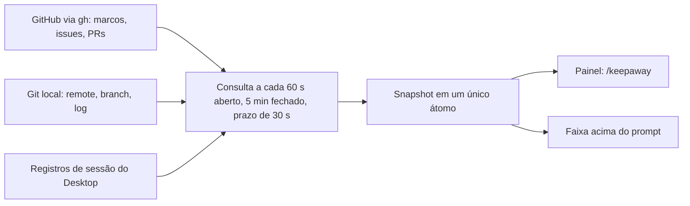
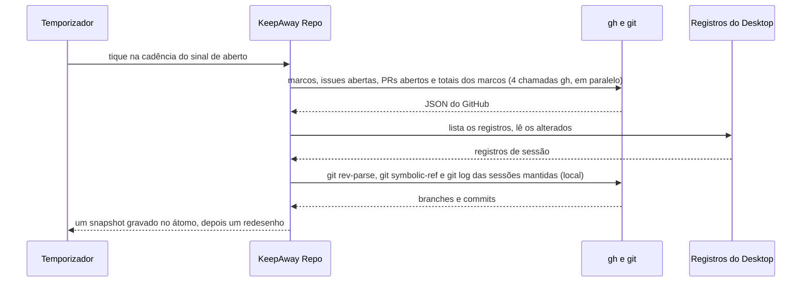

<div align="center">





# 🧭 KeepAway Repo

[](README.md) [-green.svg)](README.pt-BR.md)

**Um mod do Claude Code Desktop para quem mantém várias sessões em um mesmo repositório do GitHub. Ele mostra qual issue cada sessão está trabalhando, e o que o repositório está fazendo agora.**

[](CHANGELOG.md) [](LICENSE) 

[🌐 Site](https://keepglide.com/pt-br/keeptrack) · [Instalação](#-instalação) · [Uso](#-uso) · [Changelog](CHANGELOG.md) · [Reportar um bug](https://github.com/KeepGlide/keeptrack/issues/new) · [Segurança](SECURITY.md)

</div>

<details>
<summary><strong>📑 Conteúdo</strong></summary>

- [📌 Status](#-status)
- [💡 Por que existe](#-por-que-existe)
- [🎁 O que entrega](#-o-que-entrega)
- [📸 Screenshots](#-screenshots)
- [⚙️ Como funciona](#%EF%B8%8F-como-funciona)
- [📋 Pré-requisitos](#-pré-requisitos)
- [🚀 Instalação](#-instalação)
- [🤖 Instalação por um agente de IA (spec)](#-instalação-por-um-agente-de-ia-spec)
- [🔄 Atualização](#-atualização)
- [🧹 Desinstalação](#-desinstalação)
- [🧭 Uso](#-uso)
- [🎛️ Configuração](#%EF%B8%8F-configuração)
- [📚 Documentação](#-documentação)
- [🔒 Segurança e privacidade](#-segurança-e-privacidade)
- [🩺 Solução de problemas](#-solução-de-problemas)
- [🐞 Problemas conhecidos](#-problemas-conhecidos)
- [🧪 Testes](#-testes)
- [🔧 Desenvolvimento](#-desenvolvimento)
- [🌿 Branches e releases](#-branches-e-releases)
- [📝 Changelog](#-changelog)
- [🤝 Contribuindo](#-contribuindo)
- [🧑‍🔧 Mantenedora](#-mantenedora)
- [📄 Licença](#-licença)

</details>

## 📌 Status

Beta (`0.2.0-beta.24`). O projeto segue o [SemVer](https://semver.org/): enquanto a versão for `0.y.z`, qualquer release pode mudar o comportamento sem aviso.

## 💡 Por que existe

Quando um repositório tem várias sessões do Desktop abertas ao mesmo tempo, cada sessão mostra só a própria conversa. Nada indica qual sessão trabalha em qual issue, quais issues nenhuma sessão toca, ou se alguma sessão está esperando por você. O KeepAway Repo lê essas informações do GitHub e desta máquina, e as mostra em dois lugares: um painel e uma faixa acima do prompt.

Ele é para uma pessoa em uma máquina: lê os registros de sessão dessa máquina.

Ele **não** altera nada no GitHub nem no seu repositório. Não registra tempo, não guarda relatórios e não sincroniza entre máquinas.

## 🎁 O que entrega

- **`/keepaway`** abre o painel (`/keepaway open` faz o mesmo). `/keepaway issue <n>` define a issue desta janela, `/keepaway issue none` a limpa, e `/keepaway lang en|pt-BR|auto` define o idioma.
- **Esta janela primeiro**: a sessão da janela com os detalhes e a linha do tempo da sua issue.
- **Tarefa atual e linha do tempo**: cada sessão mostra `Agora: <tarefa>` (a etapa do plano em andamento) e as etapas do plano, commits e PR, da mais nova para a mais antiga; as 5 mais novas aparecem e o resto fica atrás de `▸ Anteriores (N)`.
- **Sessões agrupadas como na barra lateral do Desktop**: no topo o rótulo do grupo, em negrito simples, abaixo as sessões dele. Uma sessão que está num Grupo da barra lateral do Desktop (o dela ou o da raiz dela) é desenhada sob o nome do Grupo; toda sessão sem Grupo fica num único grupo com o rótulo `Recents`, como a barra lateral do Desktop as chama. O rótulo é `Recents` nos dois idiomas, porque o app do Desktop não tem rótulo traduzido, e um Grupo do Desktop chamado "Recents" mantém o rótulo próprio ao lado dele. Cada sessão do topo é uma linha `├`/`└` com título, estado, issue e milestone, e as derivadas (fork ou spawn) ficam aninhadas embaixo dela, a 1, 3 e 5 células. Primeiro vem o grupo desta janela, depois os Grupos com nome pela atividade mais recente, e por último `Recents`; dentro de um grupo, primeiro a sessão desta janela, depois as que esperam você, depois as mais recentes. Cada título de sessão leva à sessão no Desktop.
- **Sessões encerradas não são listadas**: uma sessão arquivada no Desktop sai da árvore na hora, a menos que seja a sessão desta janela. Uma raiz arquivada não é desenhada: as derivadas ativas dela viram linhas do grupo delas (`Recents` quando não têm Grupo), com o título da mãe na linha do tempo.
- **Issues abertas por milestone**: as issues abertas que nenhuma sessão trabalha, agrupadas por milestone aberto, com o progresso do milestone. Os milestones ordenam pelo prazo, o mais cedo primeiro; dentro de um grupo as issues ordenam por prioridade (`P0` a `P3`, lida dos rótulos), e cada linha traz a sua marca.
- **Uma faixa acima do prompt** com o estado desta janela: executando ou ociosa, a ferramenta ou o servidor MCP atual com seu ícone, a quantidade de agentes, o tempo decorrido, um estado de espera por você, um estado de erro de dados, o progresso do milestone e o número da issue. A faixa mostra o estado só pelo ícone, sem palavra.
- **Um botão Open** na faixa, com a marca KeepGlide antes dele (a marca aparece só no Desktop).
- **Inglês e português do Brasil** no painel e na faixa.
- **Logo do repositório**: no desktop, a linha de uma sessão mostra o logo do repositório (16 px) antes do título, quando o repositório tem um: um arquivo de logo PNG ou JPEG no checkout (sem SVG), senão o conteúdo do GitHub, senão o avatar de uma organização do GitHub dona do repositório. Um repositório GitLab recebe o avatar do projeto pelo `glab`. Um remoto nomeado por um alias de SSH é lido como o host para o qual o alias resolve. Sem logo, nada é desenhado.
- **Links**: no desktop o título de uma sessão abre essa sessão. No desktop, milestones, commits, PRs e issues levam às suas páginas.
- **Riscos primeiro**: acima das sessões, chips para milestone atrasado (⚠️), milestone que vence em até 14 dias (📅, `vence hoje` no dia) e as outras sessões que pararam esperando você (⏳, com os números das issues); depois `14 de 24 fechadas nos milestones abertos`, a barra, as issues que faltam e as sessões trabalhando.
- **Sessões em espera**: outra sessão cujo último turno parou precisando de você (o resumo de fim de turno do Desktop, última atividade há menos de 24 h) mostra ⏳ e uma linha `Precisa de você:` de até 90 caracteres, e vem logo depois da sessão desta janela. Um grupo lista 20 sessões de topo e depois `+k mais`.
- **Resumo de cada sessão**: uma linha logo abaixo do título da sessão com o primeiro prompt, limpo e cortado em 93 caracteres, sem rótulo. `/keepaway summary off` esconde a linha.
- **Decisões e objetivos**: o bloco desta janela mostra `Decidido:` a partir do comentário mais novo da issue, do dono, de um membro ou de um colaborador, que começa com `Decisão:` ou `Decision:`; cada milestone mostra sua descrição como `Objetivo:`.
- **Ícones depois do título**: estado (🟢 trabalhando, ⏳ esperando você, 💤 ociosa, sem palavra de estado), a linha do tempo (📝 commit, 🔀 PR, 🚀 sessão), issues a fazer (📋) ou em andamento (🛠️), milestones (🎯) com barra de progresso em texto, prazo (📅) e marca de atraso (⚠️), e prioridades (🔴 P0, 🟠 P1, 🟡 P2, ⚪ P3). A legenda no rodapé do painel, uma sanfona chamada Labels Descriptions que começa fechada, nomeia cada um. A tabela completa está na [SPEC, seção 19](plugins/keepaway-repo/SPEC.md). As capturas ainda mostram o desenho anterior aos ícones.

## 📸 Screenshots

> [!NOTE]
> **Mockups de design, não capturas.** As duas imagens abaixo são o mockup de design aprovado do layout com sessões em primeiro lugar (claro e escuro), não capturas do app Desktop em execução.

| Claro | Escuro |
|---|---|
|  |  |

> [!IMPORTANT]
> **As capturas reais estão pendentes.** Elas aguardam a conferência da Sophia com o mod rodando no Claude Code Desktop ([SPEC §17](plugins/keepaway-repo/SPEC.md#17-desktop-check-for-sophia)). Até lá, os espaços abaixo ficam sem imagem.

| Tela | Captura |
|---|---|
| Painel, tema claro | Pendente da conferência da Sophia no Desktop (SPEC §17) |
| Painel, tema escuro | Pendente da conferência da Sophia no Desktop (SPEC §17) |
| Faixa acima do prompt | Pendente da conferência da Sophia no Desktop (SPEC §17) |

## ⚙️ Como funciona



A volta principal de uma consulta:



O temporizador consulta a cada 60 segundos enquanto o painel está aberto, e a cada 5 minutos enquanto ele está fechado, para a faixa continuar atualizada. Uma consulta que não termina em 30 segundos é abandonada, e uma nova consulta pode começar. O painel e a faixa só leem o snapshot; não chamam processo nem arquivo.

O mapeamento de sessão para issue usa a primeira correspondência e nunca junta duas sessões. As regras completas estão na [especificação](plugins/keepaway-repo/SPEC.md), em inglês.

## 📋 Pré-requisitos

- Claude Code Desktop com o carregador de mods.
- [`gh`](https://cli.github.com/), com login feito por `gh auth login` e com acesso de leitura ao repositório.
- `git`, e um repositório com um remote no GitHub: `origin`, ou o primeiro remote quando não há `origin`. Um remote em outro host aparece como `no GitHub remote`.

| Plataforma | Status | Observações |
|---|---|---|
| Claude Code Desktop no Linux | ✅ | |
| Claude Code Desktop no macOS | ⚠️ | Não testado. O caminho padrão dos registros é o mesmo `~/.config/Claude/claude-code-sessions`; o código não o verifica no macOS. |
| Claude Code Desktop no Windows | ⚠️ | Não testado. As duas pastas padrão são montadas a partir de `HOME`; sem `HOME`, o código não encontra nenhuma pasta. |

## 🚀 Instalação

O KeepAway Repo é instalado pelo `sophia-mods`, o marketplace local dos mods do Claude Code da Sophia: a pasta `~/.claude/mods`, cujo `.claude-plugin/marketplace.json` lista o `keepaway-repo`.

### 1️⃣ Adicione o marketplace (uma vez por máquina)

Pule este passo quando `claude plugin marketplace list` já mostrar `sophia-mods`.

```bash
claude plugin marketplace add ~/.claude/mods
```

### 2️⃣ Instale o plugin

```bash
claude plugin install keepaway-repo@sophia-mods
```

### 3️⃣ Carregue o plugin

Reinicie o Claude Code, ou rode `/reload-plugins` se a sua versão tiver esse comando. Depois, rode `/keepaway` em uma sessão de um repositório com remote no GitHub.

<details>
<summary><strong>Caminho manual: carregar o mod de um clone, sem marketplace</strong></summary>

Clone este repositório (ele é privado: você precisa de acesso de leitura) e inicie o Claude Code com a pasta do mod. A flag `--plugin-dir` carrega o plugin só para aquela sessão, então repita a cada início. Não conferido no Claude Code Desktop.

```bash
git clone https://github.com/KeepGlide/keeptrack.git
```

```bash
claude --plugin-dir keeptrack/plugins/keepaway-repo
```

</details>

> [!NOTE]
> **Catálogo KeepGlide: pendente.** O catálogo KeepGlide ([KeepGlide/claude-plugins](https://github.com/KeepGlide/claude-plugins)) ainda não tem uma entrada `keepaway`. Quando a entrada for publicada, a instalação por ele será `claude plugin marketplace add KeepGlide/claude-plugins` e depois `claude plugin install keepaway-repo@keepglide`, e os comandos de atualização e desinstalação abaixo levam `@keepglide` no lugar de `@sophia-mods`. Esses comandos ainda não foram executados para este plugin.

## 🤖 Instalação por um agente de IA (spec)

> **Para o agente:** siga esta spec passo a passo e compare cada resultado com **Expect**. Pare e relate à pessoa a qualquer divergência. As instruções da sua usuária vêm primeiro. A spec instala pelo marketplace `sophia-mods`, como faz a [Instalação](#-instalação).

Regras de base:

- 🔑 **Segredos:** o agente nunca lê, digita nem imprime um token ou chave. O `gh` usa o próprio login; a pessoa roda `gh auth login` se o passo 1 falhar.
- 🧑 **Com OK da pessoa:** os passos 3, 4 e os passos de desfazer mudam a configuração do Claude Code (marketplace, instalação e remoção do plugin). Pergunte antes.
- 💸 **Custo:** nenhum passo custa dinheiro. O mod chama só `gh` e `git` (veja [Segurança e privacidade](#-segurança-e-privacidade)).
- **Plataformas:** Linux é ✅ (veja [Pré-requisitos](#-pré-requisitos)); macOS e Windows são ⚠️, não testados. Os passos 5 a 8 rodam em uma sessão do Claude Code Desktop, não em um terminal comum.

| # | Passo | Rodar | Expect |
|---|---|---|---|
| 1 | Conferir se o gh está logado | `gh auth status` | Saída 0 e uma linha `Logged in to github.com`. Se não, a pessoa roda `gh auth login`. |
| 2 | Conferir se o repositório tem um remote no GitHub | `git remote get-url origin` | Saída 0 e uma URL cujo host é `github.com`, ou um alias SSH com `github` no nome (por exemplo `git@github-<label>:<owner>/<repo>.git`). Se não, o painel mostra `sem remote no GitHub para este repo`. |
| 3 🧑 | Adicionar o marketplace, a menos que `claude plugin marketplace list` já mostre `sophia-mods` | `claude plugin marketplace add ~/.claude/mods` | Saída 0, e `claude plugin marketplace list` mostra `sophia-mods` com `Source: Folder (<path>)`. |
| 4 🧑 | Instalar o plugin | `claude plugin install keepaway-repo@sophia-mods` | Saída 0, e `claude plugin list` mostra `keepaway-repo@sophia-mods` com `Version: 0.2.0-beta.24` e `Status: ✔ enabled`. |
| 5 | Conferir se o comando está registrado | Em uma sessão do Desktop, `/keepaway bogus` | Um toast com a linha de uso `Usage: /keepaway open \| issue <n> \| issue none \| lang en\|pt-BR\|auto` em inglês, ou `Uso: /keepaway open \| issue <n> \| issue none \| lang en\|pt-BR\|auto` em português. Nada muda. |
| 6 | Abrir o painel | `/keepaway` | Abre um painel com o título `KeepAway Repo`. Mostra `Carregando o repo...`, depois as issues abertas por milestone, ou uma linha de erro de [Solução de problemas](#-solução-de-problemas). |
| 7 | Trocar o idioma para português | `/keepaway lang pt-BR` | O painel e a faixa mudam para português. Durante o carregamento, o painel mostra `Carregando o repo...`. |
| 8 | Voltar ao idioma automático | `/keepaway lang auto` | A escolha guardada é removida. O idioma segue a primeira variável definida entre `LC_ALL`, `LC_MESSAGES`, `LANG` ou `LANGUAGE`: `pt*` dá português; qualquer outra coisa dá inglês. |
| 9 | Conferir se o gh lê o repositório | `gh issue list -R <owner>/<repo> --state open --limit 1 --json number` | Saída 0 e um array JSON: `[]` ou `[{"number":<n>}]`. |
| 10 | Devolver à pessoa | nenhum | Relatar à pessoa o resultado de cada passo, a saída do passo 9 e qualquer passo pulado. Nenhum token é impresso. |

✅ **Pronto quando:** os passos 1, 2 e 9 batem; os passos 3 e 4 batem; os passos 5 a 8 batem em uma sessão do Desktop.

**Relatório:** o resultado de cada passo, a saída do passo 9 e cada passo pulado com o motivo.

**Desfazer** (🧑 a pessoa decide):

1. Rode `/keepaway lang auto` e `/keepaway issue none` em cada janela onde foram usados.
2. Rode `claude plugin uninstall keepaway-repo@sophia-mods`.
3. Rode `claude plugin marketplace remove sophia-mods` só se o passo 3 o adicionou e nenhum outro plugin usar esse marketplace.

## 🔄 Atualização

Atualize o marketplace e depois o plugin. A atualização imprime `updated from <old> to <new>` e `Restart to apply changes`.

```bash
claude plugin marketplace update sophia-mods
```

```bash
claude plugin update keepaway-repo@sophia-mods
```

Reinicie o Claude Code, ou rode `/reload-plugins`, depois de uma atualização, como depois de uma instalação.

## 🧹 Desinstalação

```bash
claude plugin uninstall keepaway-repo@sophia-mods
```

Reinicie o Claude Code, ou rode `/reload-plugins`, depois. O que o mod deixa para trás:

| Item | Onde fica | Depois da desinstalação |
|---|---|---|
| Código e hooks do plugin | Instalação de plugins do Claude Code | Removidos por `claude plugin uninstall`. |
| Idioma guardado (`lang`) e issues de janela (`override:<id da sessão>`) | Armazenamento do mod no Claude Code | Ficam. O mod não tem nenhum passo que os apague. As substituições expiram em 30 dias, ou antes, quando nenhum registro de sessão lista a sessão. Para limpar o idioma antes, rode `/keepaway lang auto`. |
| Registros de sessão e config do Desktop | `~/.config/Claude/claude-code-sessions`, `~/.config/Claude/claude_desktop_config.json` (só os Grupos da barra lateral e as sessões de cada um são lidos) | Não são tocados. O mod só os lê. |
| GitHub e o repositório | GitHub e a sua árvore de trabalho | Não são tocados. O mod não grava nada lá. |

## 🧭 Uso

| Comando | O que faz |
|---|---|
| `/keepaway` ou `/keepaway open` | Abre o painel. Consulta na hora quando o snapshot é mais antigo que um intervalo. O botão Open da faixa faz o mesmo. |
| `/keepaway issue <n>` | Define a issue desta janela, de 1 a 999999. Guardada por sessão como `override:<id da sessão>` por 30 dias. Só uma sessão do Desktop pode defini-la; qualquer outra janela recebe um toast. |
| `/keepaway issue none` | Limpa a issue desta janela. |
| `/keepaway lang en\|pt-BR\|auto` | Guarda o idioma (não importa maiúsculas) e troca na hora. `auto` remove a escolha guardada e segue o ambiente. |
| `/keepaway summary on\|off` | Mostra ou esconde a linha de resumo de cada sessão (ligada por padrão). Desligada, nenhum transcript é lido. |
| Qualquer outro argumento | Um toast com a linha de uso. Nada muda. Palavras a mais depois de `open` ou de `issue <n>` (por exemplo `/keepaway open now`) contam como outro argumento. |

## 🎛️ Configuração

| Nome | Padrão | Efeito |
|---|---|---|
| `KEEPAWAY_POLL_MS` | `60000` | Intervalo de consulta com o painel aberto. Um valor abaixo de 1000, ou que não seja número inteiro, é ignorado e vale o padrão. |
| `KEEPAWAY_BAND_POLL_MS` | `300000` | Intervalo de consulta com o painel fechado. Mesma regra de `KEEPAWAY_POLL_MS`. |
| `KEEPAWAY_DESKTOP_SESSIONS` | `$HOME/.config/Claude/claude-code-sessions` | Pasta de registros de sessão que é lida (somente leitura). Definida para os testes. |
| `LC_ALL`, `LC_MESSAGES`, `LANG`, `LANGUAGE` | sem valor | Idioma quando nenhuma escolha está guardada: decide a primeira variável definida. `pt*` dá português; qualquer outra coisa dá inglês. Uma escolha guardada com `/keepaway lang` sempre vence. |

A pasta padrão é montada a partir de `HOME`. Sem `HOME`, o mod não encontra a pasta de registros.

Fixo no código, não configurável:

| Ajuste | Valor | Onde |
|---|---|---|
| Prazo de uma consulta | 30 s | `POLL_DEADLINE_MS`, `plugins/keepaway-repo/hooks/register.tsx` |
| Tique de redesenho da faixa | 30 s | `BAND_TICK_MS`, `plugins/keepaway-repo/hooks/register.tsx` |
| Timeout de chamada do gh | 15 s | `GH_TIMEOUT_MS`, `plugins/keepaway-repo/hooks/register.tsx` |
| Timeout de chamada do git | 5 s | `GIT_TIMEOUT_MS`, `plugins/keepaway-repo/hooks/register.tsx` |
| Issues abertas por consulta | 500 | `ISSUE_LIMIT`, `plugins/keepaway-repo/hooks/register.tsx` |
| Pull requests abertos por consulta | 100 | `PR_LIMIT`, `plugins/keepaway-repo/hooks/register.tsx` |
| Corte de sessões recentes | 72 h | `SESSION_CUTOFF_MS`, `plugins/keepaway-repo/hooks/register.tsx` |
| Validade de uma issue de janela | 30 dias | `OVERRIDE_TTL_MS`, `plugins/keepaway-repo/hooks/register.tsx` |
| Consultas abandonadas ao mesmo tempo | 2 | `MAX_ABANDONED_POLLS`, `plugins/keepaway-repo/hooks/register.tsx` |
| Janela do estado "trabalhando" | 5 min após a última atividade | `WORKING_WINDOW_MS`, `plugins/keepaway-repo/hooks/model.ts` |

## 📚 Documentação

- [SPEC.md](plugins/keepaway-repo/SPEC.md): o que o código faz hoje, e em que ele difere do registro de design (em inglês).
- [CONTRIBUTING.md](CONTRIBUTING.md): o layout do repositório e o protocolo de testes (em inglês).
- [CHANGELOG.md](CHANGELOG.md): cada mudança, por versão (em inglês).

## 🔒 Segurança e privacidade

- **O que sai da máquina:** só chamadas do `gh` ao GitHub, para ler milestones, issues abertas, pull requests abertos, os totais dos milestones e os detalhes de uma issue. Não há chamadas pagas nem chamadas a outros serviços. Para os logos, o conteúdo do repositório e o tipo do dono pelo `gh`, o avatar da organização em `avatars.githubusercontent.com` (só https) e o avatar do GitLab pelo `glab`.
- **O que é lido localmente:** o remote, a branch e o log do git do repositório e das suas sessões, os registros de sessão do Desktop, e a config do Desktop (só os Grupos da barra lateral). Com o resumo ligado, os primeiros 256 KiB do transcript de cada sessão listada, para o primeiro prompt; o resumo fica só na memória e nunca é gravado.
- **O que é gravado:** só o estado do mod (o sinal de aberto, o idioma e a issue definida por `/keepaway issue`). Nada é gravado no GitHub nem no repositório.
- Para reportar uma vulnerabilidade, veja [SECURITY.md](SECURITY.md).

## 🩺 Solução de problemas

| Sintoma | Causa | Solução |
|---|---|---|
| `claude plugin install keepaway-repo@keepglide` não encontra o plugin | A entrada do catálogo ainda não foi publicada (veja [Instalação](#-instalação)). | Instale pelo `sophia-mods`, ou aguarde a entrada. |
| `gh not found: showing sessions only` (`gh não encontrado: mostrando só as sessões`) | O `gh` não inicia (não instalado, ou fora do caminho que o Claude Code enxerga). | Instale o [`gh`](https://cli.github.com/) e confira com `gh --version`. |
| `gh is not signed in` (`gh sem login`) | O `gh` sai com uma mensagem de login. | Rode `gh auth login`. A próxima consulta já usa o login (60 s com o painel aberto, 5 min fechado). |
| `GitHub rate limit: showing the last data` (`limite do GitHub: mostrando o último dado`) | Foi atingido o limite de requisições da API do GitHub. | Aguarde. O último dado fica na tela até uma consulta dar certo. |
| `GitHub did not answer in time` (`o GitHub não respondeu a tempo`) | Uma chamada do `gh` passou de 15 s. | Confira a rede e rode a chamada que falhou à mão. A próxima consulta tenta de novo. |
| `GitHub did not answer as expected: showing the last data` (`O GitHub não respondeu como esperado: mostrando os últimos dados`) | Uma chamada do `gh` falhou sem causa conhecida, ou a saída não pôde ser lida. | Rode `gh issue list -R <owner>/<repo> --state open` à mão para ver o erro. |
| `no GitHub remote for this repo` (`sem remote no GitHub para este repo`) | O repositório não tem remote no GitHub. | Confira com `git remote -v`. O remote deve apontar para `github.com`, ou para um alias SSH com `github` no nome. |
| `list is partial (first 500)` (ou `first 100`) (`lista parcial (primeiros 500)`) | O repositório tem mais issues abertas (ou pull requests abertos) do que uma consulta lê. Exatamente 500 issues abertas não mostram a linha. | Nada no mod. A lista é parcial por desenho. |
| `{count} session records could not be read` (`{count} registros de sessão não puderam ser lidos`) | Um arquivo de registro não foi lido, ou um campo de texto passa de 4096 caracteres. Para um registro, a linha diz `1 registro de sessão não pôde ser lido` (`1 session record could not be read` em inglês). Só arquivos `local_<id>.json` são lidos como registros; os outros arquivos da pasta, como `scheduled-tasks.json` e as marcas `deleted_<id>`, são ignorados. | O registro ruim é pulado e as outras sessões são mostradas. |
| `git failed in this folder · sessions shown without branch` (`git falhou nesta pasta · sessões sem branch`) | O `git` falhou na pasta de uma sessão. | Confira se a pasta existe e se `git status` funciona lá. |
| `This window is not a Desktop session: nothing to set` (`Esta janela não é uma sessão do Desktop: nada a definir`) | `/keepaway issue` foi rodado em uma janela sem registro do Desktop. | Rode o comando em uma janela de sessão do Desktop. |
| O painel fica em `Loading the repo...` (`Carregando o repo...`) | A primeira consulta não terminou, ou foi abandonada após 30 s. | Aguarde uma consulta. O mod registra `poll skipped` quando há duas consultas abandonadas ainda rodando, e então não inicia outra até uma terminar. |

## 🐞 Problemas conhecidos

Nenhum problema conhecido em aberto em 2026-10-22. Achou um? [Abra uma issue](https://github.com/KeepGlide/keeptrack/issues/new).

Limitações conhecidas, como o código se comporta hoje:

- **Um pull request mesclado não vincula a sua issue.** Só pull requests abertos são consultados, então uma issue cujo PR foi mesclado não mostra esse PR. Contorno: `/keepaway issue <n>` na janela define a issue à mão.
- **Sessões arquivadas nunca são listadas.** Uma sessão arquivada sai da árvore na hora, mesmo quando a branch dela tem um PR aberto, a menos que seja a sessão desta janela. As derivadas ativas dela continuam listadas no grupo delas, com o título dela só na linha do tempo. Contorno: nenhum; reabra a sessão pela barra lateral do Desktop para vê-la de novo.
- **Checks sempre mostram `no CI`.** O mod lê o resumo de checks dos pull requests abertos, mas a linha Checks sempre mostra `no CI`, porque os detalhes da issue não repassam esse valor. Os repositórios KeepGlide não rodam GitHub Actions. Contorno: nenhum.
- **O estado "trabalhando" é uma heurística.** Uma sessão conta como trabalhando por 5 minutos após a última atividade, então a faixa pode atrasar em relação ao estado real. Contorno: nenhum.
- **Só remotes do GitHub contam.** Um remote em outro host aparece como `no GitHub remote`. O gh é chamado sem host, então um host GitHub Enterprise cujo nome contém `github` é lido do github.com; o mantenedor aceita isso. Contorno: nenhum.
- **As listas têm limite por consulta.** São lidas 500 issues abertas e 100 pull requests abertos; além disso o painel mostra `list is partial`. Contorno: nenhum. Os totais dos milestones não vêm da lista cortada: o GraphQL os conta, para os primeiros 100 milestones abertos.

## 🧪 Testes

| Categoria | Testes |
|---|---|
| Regras: leitura de remote, árvore de sessões, grupos de issues, linhas do tempo, projeção de registros, leitura do fuso UTC (`tests/model.test.ts`) | 125 |
| Módulo de hooks: consulta, comando do painel, temporizadores, fechamento, fuso UTC do host e leitura das etapas do plano (`tests/register.test.ts`) | 213 |
| Faixa: linha de status, estados e botão Open (`tests/band.test.ts`) | 41 |
| Painel: desenho do snapshot, relógio do host, datas de prazo e o acordeão Anteriores (`tests/pane.test.ts`) | 119 |
| Idioma: dicionários em inglês e português do Brasil (`tests/i18n.test.ts`) | 10 |
| Transições de turno da faixa (`tests/turn.test.ts`) | 8 |
| Logo do repo: busca do arquivo, checagem da imagem e script de download do avatar (`tests/repo-logo.test.ts`) | 15 |
| Resumo: limpeza do transcript, cortes, a varredura linear das tags e a linha condensada (`tests/summary.test.ts`) | 30 |
| Etapas do plano: entradas de update_plan e TodoWrite, eventos e a etapa atual (`tests/steps.test.ts`) | 7 |
| **Total** | **568** |

Contagens de `claude plugin test plugins/keepaway-repo` na árvore 0.2.0-beta.24 (a tarefa atual e o acordeão Anteriores): 568 aprovados, 0 falhas, 9 arquivos. A verificação de aparência (`scripts/keepaway-look-selftest.sh`) é um script de shell e não entra na contagem.

## 🔧 Desenvolvimento

Da raiz do repositório, valide o manifesto, os hooks e os tipos:

```bash
claude plugin validate plugins/keepaway-repo
```

Rode os testes:

```bash
claude plugin test plugins/keepaway-repo
```

Rode a verificação de aparência, que falha em qualquer cor hexadecimal, função de cor ou emoji no código desenhado (`action-icons.ts` fica isento só da verificação de emoji):

```bash
bash plugins/keepaway-repo/scripts/keepaway-look-check.sh
```

A organização do repositório e o protocolo de testes estão em [CONTRIBUTING.md](CONTRIBUTING.md), em inglês.

## 🌿 Branches e releases

`main` é a única branch de longa duração. Faça cada mudança em uma branch curta a partir de `main`, mantenha-a pequena, rode os testes e abra um pull request. Releases são tags SemVer em `main`, cada uma com a sua entrada em [CHANGELOG.md](CHANGELOG.md). Ainda não há GitHub Release publicada.

## 📝 Changelog

As mudanças de cada versão estão em [CHANGELOG.md](CHANGELOG.md), no formato [Keep a Changelog](https://keepachangelog.com/en/1.1.0/). O projeto segue o SemVer.

## 🤝 Contribuindo

Pull requests são bem-vindos. Leia antes o [CONTRIBUTING.md](CONTRIBUTING.md), em inglês.

## 🧑‍🔧 Mantenedora

Sophia Phillipa (KeepGlide), [keepglide.com](https://keepglide.com).

## 📄 Licença

MIT. Copyright (c) 2026 Sophia Phillipa (KeepGlide). Identificador SPDX: `MIT`. Veja [LICENSE](LICENSE).
