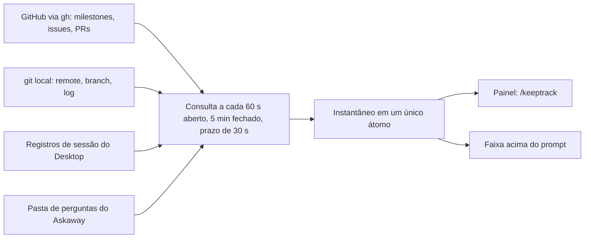
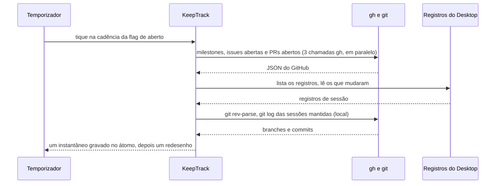

# 🧭 KeepTrack

[](README.md) [-green.svg)](README.pt-BR.md)

O KeepTrack é um mod do Claude Code Desktop que mostra em qual issue cada sessão de um repositório trabalha, e o que o repositório está fazendo agora.

 

## 📌 Status

Beta (`0.2.0-beta.5`). O projeto segue o [SemVer](https://semver.org/): enquanto a versão for `0.y.z`, qualquer release pode mudar o comportamento sem aviso.

## 💡 Por que existe

Quando um repositório tem várias sessões do Desktop abertas ao mesmo tempo, cada sessão mostra só a própria conversa. Nada diz qual sessão trabalha em qual issue, quais issues nenhuma sessão toca, ou se uma sessão está esperando por você. O KeepTrack lê essa informação do GitHub e desta máquina, e a desenha em dois lugares: um painel e uma faixa acima do prompt.

Ele **não** muda nada no GitHub nem no seu repositório. Não mede tempo, não guarda relatórios e não sincroniza entre máquinas.

## 🎁 O que ele entrega

- **`/keeptrack`** abre o painel. `/keeptrack issue <n>` define a issue desta janela, e `/keeptrack issue none` a limpa. `/keeptrack lang en|pt-BR|auto` define o idioma.
- **Esta janela primeiro**: a sessão da janela com os detalhes da issue e a linha do tempo.
- **Sessões aninhadas**: as outras sessões do Desktop do mesmo repositório, sob a sessão-mãe quando são derivadas (fork ou spawn). O título de cada sessão é um link para a sessão no Desktop.
- **Issues abertas por milestone**: as issues abertas que nenhuma sessão trabalha, agrupadas por milestone aberta, com o progresso da milestone.
- **Uma faixa acima do prompt** com o estado desta janela: executando ou ociosa, a ferramenta ou o servidor MCP atual com o seu ícone, o número de agentes, o tempo decorrido, um estado de aguardando você, um estado de erro de dados, o progresso da milestone e o número da issue.
- **Um botão Open** na faixa, com a marca KeepGlide antes dele.
- **Inglês e português do Brasil** no painel e na faixa.

## 📸 Screenshots

> **Mockups de design, não capturas.** As duas imagens abaixo são o mockup de design aprovado do layout com a sessão primeiro (claro e escuro), não capturas do app Desktop em execução. Capturas reais da faixa e do painel saem com a próxima release.

| Claro | Escuro |
|---|---|
|  |  |

## ⚙️ Como funciona



A ida e volta principal de uma consulta:



Uma consulta que não termina em 30 segundos é abandonada, e uma consulta nova pode começar. O painel e a faixa só leem o instantâneo; não chamam nenhum processo nem nenhum arquivo.

O mapeamento sessão-para-issue fica com a primeira correspondência e nunca junta duas sessões. As regras completas estão em [a spec](plugins/keeptrack-repo-pane/SPEC.md) (em inglês).

## 📋 Pré-requisitos

- Claude Code Desktop com o carregador de mods.
- [`gh`](https://cli.github.com/), autenticado com `gh auth login`, com acesso de leitura ao repositório.
- `git`, e um repositório cujo remote aponta para o GitHub.

## 🚀 Instalação

> **Pendente:** o catálogo da KeepGlide ([KeepGlide/claude-plugins](https://github.com/KeepGlide/claude-plugins)) ainda não tem uma entrada `keeptrack`, então não há instalação em um comando. Os comandos abaixo seguem o padrão do Askaway e ainda não foram executados para este plugin. A entrada e os comandos verificados saem com a próxima release.

Quando a entrada for publicada, a instalação será:

### 1️⃣ Adicione o marketplace

```bash
claude plugin marketplace add KeepGlide/claude-plugins
```

### 2️⃣ Instale o plugin

```bash
claude plugin install keeptrack-repo-pane@keepglide
```

### 3️⃣ Carregue o plugin

Reinicie o Claude Code, ou rode `/reload-plugins` se a sua versão tiver o comando. Depois rode `/keeptrack` em uma sessão de um repositório com remote no GitHub.

### Desinstalar

```bash
claude plugin uninstall keeptrack-repo-pane@keepglide
```

## 🤖 Instalação por um agente de IA (spec)

> **Pendente.** Esta spec é escrita quando a entrada do catálogo existir, e cada **Expect** é conferido contra uma execução real. Até lá, nenhum agente deve segui-la.

## 🧭 Uso

| Comando | O que faz |
|---|---|
| `/keeptrack` ou `/keeptrack open` | Abre o painel e consulta na hora quando o instantâneo é mais antigo que um intervalo. |
| `/keeptrack issue <n>` | Define a issue desta janela. O valor é guardado por sessão. |
| `/keeptrack issue none` | Limpa a issue desta janela. |
| `/keeptrack lang en\|pt-BR\|auto` | Guarda o idioma e troca na hora. `auto` segue o ambiente. |

## 🎛️ Configuração

| Nome | Padrão | Efeito |
|---|---|---|
| `KEEPTRACK_POLL_MS` | `60000` | Intervalo de consulta com o painel aberto. Mínimo de 1000 ms. |
| `KEEPTRACK_BAND_POLL_MS` | `300000` | Intervalo de consulta com o painel fechado. Mínimo de 1000 ms. |
| `KEEPTRACK_DESKTOP_SESSIONS` | Pasta do Desktop sob o diretório pessoal | Raiz dos registros lida no lugar do padrão. Usada nos testes. |

Fixo no código, não configurável: o prazo da consulta é de 30 segundos (`POLL_DEADLINE_MS` em `plugins/keeptrack-repo-pane/hooks/register.tsx`), e a faixa é redesenhada a cada 30 segundos (`BAND_TICK_MS`).

## 🔒 Segurança e privacidade

- **O que sai da máquina:** só chamadas `gh` ao GitHub, para ler milestones, issues abertas, pull requests abertos e os detalhes de uma issue. Não há chamadas pagas nem chamadas a outros serviços.
- **O que é lido localmente:** o remote, o branch e o log do git do repositório e das suas sessões, os registros de sessão do Desktop e a pasta de perguntas do Askaway (`ASKAWAY_HOME`, ou `~/.claude/state/askaway`).
- **O que é gravado:** só o estado do mod (a flag de aberto, o idioma e a issue definida por `/keeptrack issue`). Nada é gravado no GitHub nem no repositório.
- Para relatar uma vulnerabilidade, veja [SECURITY.md](SECURITY.md) (em inglês).

## 🧪 Testes

| Categoria | Testes |
|---|---|
| Regras: leitura do remote, árvore de sessões, grupos de issues, linhas do tempo, projeção de registros (`tests/model.test.ts`) | 60 |
| Módulo de hooks: consulta, comando do painel, temporizadores e fechamento (`tests/register.test.ts`) | 61 |
| Faixa: linha de estado, estados e botão Open (`tests/band.test.ts`) | 36 |
| Painel: desenho do instantâneo (`tests/pane.test.ts`) | 23 |
| Idioma: dicionários em inglês e português do Brasil (`tests/i18n.test.ts`) | 8 |
| Transições de turno da faixa (`tests/turn.test.ts`) | 6 |
| **Total** | **194** |

Contagens de `claude plugin test plugins/keeptrack-repo-pane` (194 passam, 0 falham), em 2026-10-21, antes do primeiro commit.

## 🔧 Desenvolvimento

Na raiz do repositório:

```bash
claude plugin test plugins/keeptrack-repo-pane
```

```bash
bash plugins/keeptrack-repo-pane/scripts/keeptrack-look-check.sh
```

A checagem de aparência falha em qualquer cor hexadecimal, função de cor ou emoji no código desenhado. A organização do repositório e o protocolo de testes estão em [CONTRIBUTING.md](CONTRIBUTING.md) (em inglês).

## 📝 Changelog

As mudanças de cada versão estão em [CHANGELOG.md](CHANGELOG.md), no formato [Keep a Changelog](https://keepachangelog.com/en/1.1.0/). O projeto segue o SemVer.

## 🤝 Contribuindo

Pull requests são bem-vindos. Leia [CONTRIBUTING.md](CONTRIBUTING.md) antes.

## 🧑‍🔧 Mantenedora

Sophia Phillipa (KeepGlide), [keepglide.com](https://keepglide.com).

## 📄 Licença

MIT. Copyright (c) 2026 Sophia Phillipa (KeepGlide). Identificador SPDX: `MIT`. Veja [LICENSE](LICENSE).
